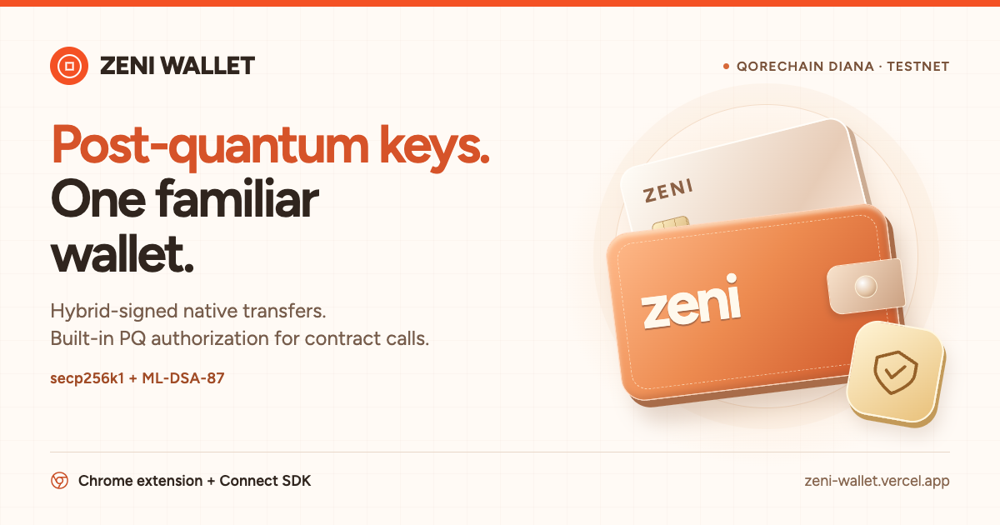

# Zeni (銭) — QoreChain Wallet

[](https://build.qorechain.io/p/zeni-wallet)

**Post-quantum keys. One familiar wallet.**

Zeni is a self-custody wallet for **QoreChain Diana testnet**. It brings classical and post-quantum keys together, hybrid-signs native transfers, and handles PQ authorization setup for EVM contract calls. Available as a Chrome extension, with a native iOS app and SDKs for connecting websites.

[Website](https://zeni-wallet.vercel.app) · [Chrome Web Store](https://chromewebstore.google.com/detail/zeni-wallet-%E2%80%94-qorechain-t/aobipbcjmngbpdhocfdgbcpgfdphlikc) · [Developer docs](https://zeni-wallet.vercel.app/docs) · [Vault demo](https://zeni-wallet.vercel.app/vault) · [QoreChain project](https://build.qorechain.io/p/zeni-wallet)



## Why Zeni?

Zeni puts QoreChain's native signing and authorization flows inside the wallet. Users can review a request, authorize the setup, and send the transaction without moving between separate tools.

| Capability | What Zeni provides |
| --- | --- |
| Two keys, one wallet | Classical `secp256k1` and post-quantum `ML-DSA-87` keys, with PQ key registration when needed. |
| Native QOR transfers | Native bank transfers signed with both classical and post-quantum signatures. |
| Native swaps | Reviewed quotes, price impact, and an enforced minimum output through Diana's native AMM. |
| Contract calls and deployment | Extension v0.1.4 handles PQ authorization setup, transaction review, signing, and broadcasting. |
| Local custody | The extension encrypts its local vault with AES-256-GCM and 600,000 PBKDF2-SHA256 iterations. The iOS app uses biometric-protected Keychain storage. |
| App integration | Direct browser-extension discovery plus encrypted QR pairing with the iOS wallet through Zeni Connect. |

### What is post-quantum signed?

| Operation | Signature behavior |
| --- | --- |
| Native QOR transfer or native AMM swap | Hybrid classical + ML-DSA-87 signatures. First-time PQ key registration is a separate classical-signed bootstrap with proof of possession. |
| EVM contract call or deployment | The authorization window is hybrid signed. The EVM transaction itself uses a classical secp256k1 signature. |
| Website message signing (`personal_sign`) | Classical EIP-191 ECDSA. A developer-facing arbitrary PQ message-signing API is not available yet. |

MetaMask can also transact on QoreChain when the required PQ authorization is arranged through compatible tooling. Zeni integrates that setup into its own approval flow. See [QoreChain's FAQ](https://build.qorechain.io/faq) and the [signing guide](docs/CONTRACT_TRANSACTIONS.md).

## Try the wallet

### Install from the Chrome Web Store

1. [Add Zeni to Chrome](https://chromewebstore.google.com/detail/zeni-wallet-%E2%80%94-qorechain-t/aobipbcjmngbpdhocfdgbcpgfdphlikc) and pin the extension.
2. Create a wallet or import your recovery phrase **inside the extension**. Set a password and keep your phrase private.
3. Get testnet QOR from the [official Diana faucet](https://dashboard.qorechain.io/faucet).
4. Send QOR, swap supported testnet assets, or connect to an app.

The repository's packaged extension is **v0.1.4**. Store updates are released separately; check your installed version before testing contract calls. Earlier builds can have narrower website permissions and method support.

### Chrome extension QOR transfers

For manual installation, download the [v0.1.4 ZIP](https://zeni-wallet.vercel.app/downloads/zeni-wallet-extension-0.1.4.zip), extract it, open `chrome://extensions`, enable **Developer mode**, and select the extracted folder with **Load unpacked**. Chrome does not load the ZIP directly. Use Chrome 124 or newer.

To build from source instead, run these commands from the repository root after installing dependencies:

```bash
pnpm --filter @zeni/core build
pnpm --filter @zeni/extension build
```

Load `apps/extension/dist`. After rebuilding an existing unpacked installation, click **Reload**, unlock Zeni, and reconnect your app.

For a native transfer, choose **Review Transfer**, inspect the recipient, amount, and fees, then **Authorize & Send**. Keep enough testnet QOR for both setup and the transfer. See the [extension usage guide](docs/EXTENSION_USAGE.md) for account recovery, native transfers, swaps, and Activity behavior.

### Test a contract interaction

Open the [Vault Lab](https://zeni-wallet.vercel.app/vault) with extension v0.1.4 or later. Connect Zeni, deploy or select a verified demo vault, then deposit and withdraw testnet QOR. Your address can withdraw only its own deposit; the demo offers no yield and needs no token spending approval.

Zeni opens a review window for `eth_sendTransaction`. It shows the destination, amount, calldata, and fee limits, then handles registration and a scoped authorization window when needed. That window permits **one EVM transaction for up to 120 blocks**, with a bounded QOR value-plus-gas budget. Calls are scoped to the reviewed destination; deployments have no existing target.

Setup fees may remain charged if the later transaction fails. An unused window stays valid until expiry. A returned EVM hash means submitted; check the receipt for confirmation. [Read the full contract flow →](docs/CONTRACT_TRANSACTIONS.md)

### Build the iOS app

The native SwiftUI app source is in [`apps/ios`](apps/ios). Open `apps/ios/Zeni.xcodeproj` in Xcode, choose the **Zeni** scheme, and run it on an iOS 17+ device or simulator. See the [iOS setup guide](apps/ios/README.md) and [Xcode update guide](apps/ios/XCODE-UPDATE.md).

## Integrate Zeni into your app

### Browser extension · React

```bash
npm install @zeni-wallet/react
```

```tsx
import { useBrowserWallet } from '@zeni-wallet/react';

export function ConnectZeni() {
  const { account, connecting, error, connect } = useBrowserWallet();

  return (
    <div>
      <button disabled={connecting || !!account} onClick={() => void connect()}>
        {account ? 'Zeni connected' : connecting ? 'Connecting…' : 'Connect Zeni'}
      </button>
      {account && <p>{account}</p>}
      {error && <p role="alert">{error}</p>}
    </div>
  );
}
```

`useBrowserWallet()` discovers Zeni through EIP-6963 or `window.zeni`, checks Diana testnet, and follows account/network changes. It also returns `provider`, `detected`, and `disconnect`. After connection, use `provider.request(...)` for wallet requests. No relay is needed. Use a client component in Next.js.

Extension v0.1.4 supports HTTPS websites and HTTP localhost/127.0.0.1, with per-site connection approval. Connecting exposes the approved address; transaction signing requires a separate wallet review.

[Browser integration](https://zeni-wallet.vercel.app/docs#browser) · [Contract request example](https://zeni-wallet.vercel.app/docs#contract-transactions) · [React package](packages/react/README.md)

### Mobile wallet · QR connection

```tsx
import { ZeniConnectProvider, ZeniConnectButton } from '@zeni-wallet/react';

export function MobileConnect() {
  return (
    <ZeniConnectProvider
      name="Your app"
      relayUrl="https://zeni-wallet.onrender.com"
    >
      <ZeniConnectButton />
    </ZeniConnectProvider>
  );
}
```

Use `useZeni()` for the mobile provider, account, connection state, and requests. For JavaScript/TypeScript without React, install [`@zeni-wallet/connect`](packages/connect/README.md).

Zeni Connect uses its own encrypted QR protocol, **not WalletConnect**. Your app's exact origin must be allowlisted on the hosted relay, or you can [self-host the relay](apps/relay/README.md). Keep the iOS app foregrounded during requests. Pairing secrets and wallet keys do not belong in application logs or remote QR-generation services.

### Supported requests

| Method | Browser extension v0.1.4 | Mobile Zeni Connect |
| --- | --- | --- |
| `eth_requestAccounts` | Approved extension connection | Approved QR pairing |
| `eth_accounts`, `eth_chainId`, `net_version` | Account and Diana network information | Account and Diana network information |
| `zeni_sendQor` | Reviewed hybrid-signed native QOR transfer | Reviewed hybrid-signed native QOR transfer |
| `personal_sign` | Reviewed classical message signature | Reviewed classical message signature |
| `eth_sendTransaction` | Reviewed EVM calls and deployment | Unsupported |
| `eth_call`, `eth_getTransactionReceipt`, other allowlisted public reads | Supported within documented limits | Unsupported |

`zeni_sendQor` returns a **64-character native transaction ID without `0x`**. Its `value` uses hexadecimal 18-decimal units, but must be an exact multiple of `10^12` because native QOR supports six decimals. `eth_sendTransaction` returns a **`0x`-prefixed EVM hash**; use the corresponding receipt API.

Handle rejections and pending requests in your app. If a response times out, check Activity and the explorer before retrying. For login, issue a fresh server-side challenge containing the domain, purpose, nonce, and expiry, then verify and consume it; a generic message signature is not a complete authentication flow.

[Full SDK docs](https://zeni-wallet.vercel.app/docs) · [Connect protocol and deployment](docs/ZENI_CONNECT.md) · [SDK release guide](docs/NPM_RELEASE.md)

## Network and current scope

- **Network:** QoreChain Diana testnet; EVM chain ID `9800` / `0x2648`.
- **Explorer:** [explore.qore.network](https://explore.qore.network). Select **Testnet** in its network selector.
- **Native swap assets:** `QOR`, `fUSD`, `fETH`, and `fBTC`, using active direct pools and spendable bank balances. Unconverted ERC-20 balances are not available to this swap flow.
- **Accounts and Activity:** Multiple derived accounts, local transaction records, and indexed incoming/external chain history. History is not a complete EVM log/trace index. See [account and Activity details](docs/EXTENSION_USAGE.md).
- **Not supported:** Mainnet, typed-data/Permit2 signing, raw signing, custom nonces, and arbitrary PQ message signing.
- **Experimental:** ERC-4337 account/factory/paymaster contracts are outside the extension's live transaction path. Daily spending caps, gas sponsorship, hybrid SIWQ login, and a Cross-VM bridge are not shipped features.

## Develop locally

Use **Node.js 22+** and **pnpm 9+**. Foundry is needed for Solidity builds/tests; Xcode is needed for iOS.

```bash
git clone https://github.com/Trymbakmahant/zeni-wallet.git
cd zeni-wallet
pnpm install
pnpm --filter @zeni/core build
pnpm build:sdk
```

Run the relevant development command in its own terminal:

```bash
pnpm dev:web      # Landing page, docs, and vault demo
pnpm dev:ext      # Extension build watcher; load apps/extension/dist in Chrome
pnpm dev:relay    # Local mobile-connection relay
pnpm dev:connect  # Standalone Connect demo
```

The local relay listens on port `8787`; the Connect demo uses `5174`. A physical phone needs a publicly reachable HTTPS relay. See the [relay deployment guide](apps/relay/README.md) for Docker, allowed origins, and session limits.

### Builds and checks

```bash
pnpm --filter @zeni/web typecheck
pnpm --filter @zeni/web build
pnpm --filter @zeni/extension typecheck
pnpm --filter @zeni/extension build
pnpm --filter @zeni/core test
pnpm --filter @zeni/extension test:security
pnpm test:connect
pnpm test:contracts       # Requires Foundry
pnpm build:vault          # Compile and export the demo vault
pnpm zip:ext              # Package the extension release
```

The ZIP is written to `artifacts/extension/` and copied to `apps/web/public/downloads/`. Browser checks are available through `test:browser`, `test:browser:extension`, and `test:browser:vault` in the extension package; see their scripts for local Chrome/Anvil prerequisites. Mocked and local-chain tests do not replace a funded Diana testnet check.

Read the [PQC verification guide](docs/PQC-VERIFICATION.md), [security review](docs/SECURITY_REVIEW.md), and [Chrome Web Store submission guide](docs/CHROME_WEB_STORE.md).

## Repository layout

```text
zeni-wallet/
├── apps/
│   ├── extension/          Chrome Manifest V3 wallet
│   ├── ios/                Native SwiftUI wallet and bundled wallet engine
│   ├── web/                Landing page, docs, and vault demo
│   ├── connect-demo/       Standalone browser/mobile integration demo
│   └── relay/              Encrypted Zeni Connect mailbox service
├── packages/
│   ├── core/               Shared crypto, signing, RPC, and transaction logic
│   ├── connect-protocol/   Pairing and encrypted transport protocol
│   ├── connect/            JavaScript/TypeScript mobile provider
│   ├── react/              React hooks, extension discovery, and QR UI
│   └── contracts/          Demo vault, PQ diagnostics, experimental accounts
├── docs/                   Integration, testing, and release guides
└── scripts/                SDK packaging and release checks
```

## Feedback and contributions

Found a bug or want an integration feature? [Open an issue](https://github.com/Trymbakmahant/zeni-wallet/issues) with the wallet version, network, and steps to reproduce. Never include a recovery phrase, private key, or pairing secret. For code changes, include the relevant checks and describe any change to signing or approval behavior.

## License

MIT
